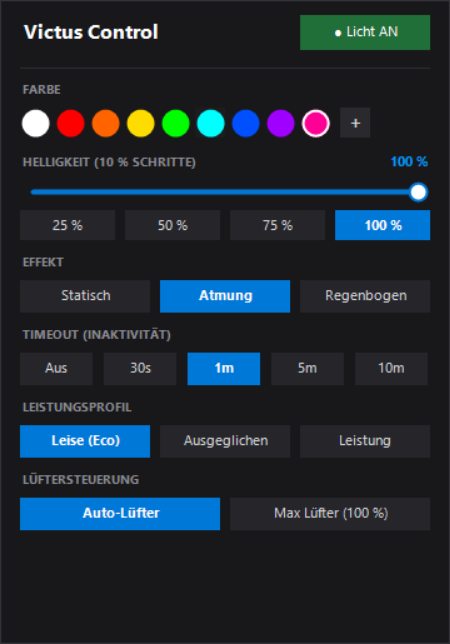

# VictusControl ⚡

> **Lightweight, bloat-free control utility for HP Victus laptops.**  
> Direct HP BIOS WMI communication (`root\wmi`, `hpqBIntM`). One small tray app (no Windows service), no ads, no telemetry.

[](https://github.com/marka87/VictusControl)
[](https://github.com/marka87/VictusControl)
[](LICENSE)

---

## 🌟 Why VictusControl?

The official **HP OMEN Gaming Hub** consumes hundreds of megabytes of RAM, runs multiple persistent background services, displays store ads, and drains laptop battery.

**VictusControl** is designed as a standalone, featherlight alternative (<20 KB single executable) that talks directly to the HP BIOS WMI layer:

| Feature | HP OMEN Gaming Hub | VictusControl |
| :--- | :--- | :--- |
| **Download / Install Size** | ~500 MB+ | **One small EXE** |
| **RAM Usage** | 200 – 400 MB | **Small** (not measured yet) |
| **Background Services** | 4 – 6 services running 24/7 | **None** (one tray app, no Windows service) |
| **Dedicated Omen Key** | Opens heavy Omen Hub | **Opens instant Quick Flyout (Bubble)** |
| **Telemetry & Ads** | Yes | **None** |
| **Dependencies** | UWP / Store / HSA Services | **None (Built into Windows)** |

---

## ✨ Features

- 🎯 **Hardware "Omen" Key Support:**  
  Intercepts the dedicated Omen key on your keyboard to instantly pop up the sleek Quick Control Flyout (Bubble).
- 🌈 **1-Zone RGB Backlight Control:**  
  Choose from 9 vibrant presets (*White, Red, Orange, Yellow, Green, Cyan, Blue, Purple, Pink*) or select any custom color via the native Windows color picker.
- 🔆 **PWM Brightness & Dimming:**  
  Interactive **slider with 10% steps** (*10% to 100%*) plus quick-access preset buttons. Real-time preview as you drag.
- 🌊 **Smooth Lighting Animations:**
  - **Breathing (Atmung):** Gentle sine wave pulsation in your selected color.
  - **Rainbow (Color Cycle):** Smooth HSV spectrum transition across all hues (~16 FPS, <0.1% CPU).
- ⏳ **Smart Inactivity Timeout:**  
  Turns off keyboard LEDs automatically when idle (*30s, 1m, 5m, 10m, or Disabled*) to save battery and reduce glare. Turns back on immediately upon key or mouse input.
- 🖥️ **External Display Brightness (HDMI / Type-C):**  
  Adjust external monitor brightness directly from the flyout. Supports hardware **DDC/CI** with an automatic click-through software dimming overlay fallback (works through USB-C hubs & docks). The primary display (usually the built-in panel, at position 0,0) is excluded from DDC/CI. If your external monitor is set as primary in Windows, DDC/CI will not reach it. Make the built-in panel the primary display in Windows display settings in that case.
- 🛡️ **Safe & Native:**  
  Interacts strictly with the HP BIOS WMI lighting interface (`hpqBIntM`). Zero tampering with system stability or Windows registry power plans.
- 💾 **Persistent Settings:**  
  All your choices are saved automatically in `%APPDATA%\VictusControl\settings.txt` and restored upon startup, sleep resume, or session unlock.

---

## 🖥️ The Quick-Control Flyout ("Bubble")

Press your laptop's **Omen key** or **left-click the tray icon** to summon the modern Quick Flyout:

<p align="center">
  
</p>

> **Auto-Close:** Clicking anywhere outside the bubble or pressing `Escape` dismisses the window cleanly.

---

## 🚀 Installation & Building

No Visual Studio, SDK, or package manager required! Windows includes the C# compiler out of the box.

### Quick Setup:
1. Clone or download this repository:
   ```bash
   git clone https://github.com/marka87/VictusControl.git
   ```
2. Run **`build.bat`** (Right-click → *Run as Administrator*).  
   It will compile `VictusControl.exe` in under two seconds.
3. To start automatically with Windows without UAC prompts:  
   Run **`install-autostart.bat`** (Right-click → *Run as Administrator*).

### Uninstall:
Run **`uninstall-autostart.bat`** (Right-click → *Run as Administrator*) and delete the folder.

---

## 🔧 How It Works

1. **WMI BIOS Communication:** Communicates with the `root\wmi` namespace using class `hpqBIntM` and method `hpqBIOSInt128` with command signature `"SECU"`.
   - Command `0x20009`: Reads and writes RGB lighting byte buffers (bytes 25, 26, 27).
   - Command `0x20008`: Controls thermal policies and fan speed triggers.
2. **Omen Hardware Key:** Listens to the WMI event `hpqBEvnt`. One key press yields one event, so the flyout opens and closes exactly once per press.
3. **Inactivity Detection:** Uses `GetLastInputInfo` in `user32.dll` to measure system-wide idle time without continuous polling overhead.

---

## 💻 Hardware Compatibility

- **Tested on:** HP Victus 16 (`16-s0xxx` AMD series, `16-d/e/r` series with 1-Zone RGB keyboard).
- **Probably compatible with:** other HP Victus models and HP laptops with 1-Zone RGB backlighting. Not tested. Reports are welcome.

---

## 📄 License

This project is licensed under the [MIT License](LICENSE) - free to use, modify, and distribute.

